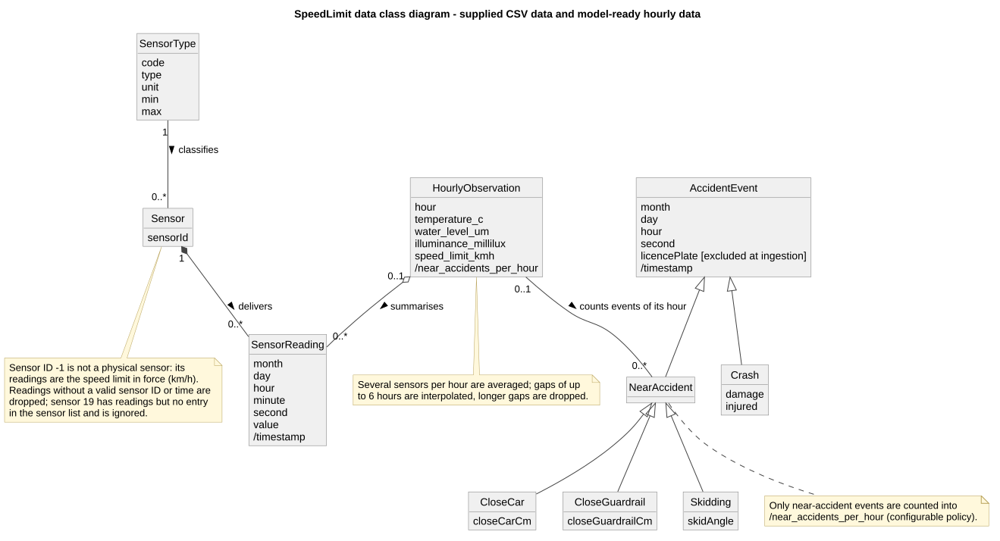

# SpeedLimit Data Model and Quality Notes

This document combines the supplied case-study data notes with the project
owner's decisions.

## 1. Supplied data files

| Data | Example supplied file | Purpose |
| --- | --- | --- |
| Sensor types | `Case_Study_Speed_Limit_SensorTypes_V100.csv` | Type code, measurement description, unit, nominal minimum and maximum. |
| Sensors | `Case_Study_Speed_Limit_Sensors_V100.csv` | Sensor ID to sensor type code mapping. |
| Sensor readings, Year N | `Case_Study_Speed_Limit_SensorReadingsYearN_V100.csv` | Timestamped sensor ID/value records; semicolon-delimited, decimal comma. |
| Accidents, Year N | `Case_Study_Speed_Limit_AccidentsYearN_V100.csv` | Event time, possible crash/near-accident attributes, and a licence-plate column. |
| Sensor readings, Year N+1 | `Case_Study_Speed_Limit_SensorReadingsYearNPlus1_V100.csv` | Following-period readings. |
| Accidents, Year N+1 | `AccidentsYearNPlus1_V100.csv` | Following-period events. |

The application does not read the two metadata files (sensor types, sensors).
The mapping it needs is fixed in [data_pipeline.py](../source/data_pipeline.py):
water 1, 8, 11; light 2, 9, 12; temperature 15, 18; speed limit -1. All
other sensors are ignored.

## 2. Data structure

In the intended model-ready data, accident events are aligned to sensor
readings by hour. Sensor ID `-1` is a special reading for the speed limit in
force, not a physical sensor. The project owner's model decision is to predict
near-accident count per hour from weather/light features and a candidate
speed.

## 3. Source-file details

The cleaning steps and hourly alignment are described in exercises 05 and 06.
The headerless Year N+1 file is assumed to use the same seven-column order as
Year N: `Month;Day;Hour;Minute;Second;Sensor;Value`. This is consistent with
the observed Year N+1 rows, but is an explicit schema assumption rather than a
header or separate Year N+1 schema confirmation.

The source files contain month/day/time but no year, so both periods are
normalized to a neutral year for features. Annual training concatenates the
known Year N rows before Year N+1 rows; the split order therefore comes from
the supplied period order, not a calendar year in the records.

## 4. Data-quality findings and handling

The table separates the course inspection notes from decisions. “Re-profile”
means confirm the issue programmatically against the exact source file before
applying a repair.

| Finding | Agreed or proposed handling | Status / stakeholder question |
| --- | --- | --- |
| For the sensor types there are two "T" types. This is confusing and a bad way of categorizing data, as one has to assume whether each T sensor is Temperature or Traffic depending on the readings and the expected temperature at that time of the year. | Assume sensor 16 is traffic and sensors 15 and 18 are temperature; sensor 16 is not a current model feature. | **Assumption recorded in [decision D-15](./project_decisions.md#2-project-decision-records).** The per-sensor types and units are not confirmed by the data owner. |
| One of the sensors, identified as "19", is not on the list. Since we cannot identify it from the supplied metadata, we decided not to use it in our NN. | Keep it unclassified and out of the model. | **Implemented:** sensor 19 has readings but no sensor-map entry. |
| We decided to exclude the LicencePlate values as they are not relevant. | Do not use licence plates in application processing, derived data, logs, or model inputs. | **Implemented at ingestion and cleaning; source files are unchanged.** |
| The case-study data describes January periods. | Do not infer full-year or all-season performance. | Broader, representative data is needed to assess other seasons and roads. |
| Sensors 7, 10, and 17 have metadata but reportedly no readings. | Treat as unused metadata unless more readings are supplied; do not fabricate measurements. | Re-profile each supplied period. |
| Sensor 18 reportedly lacks the first five hours of Jan 26; sensor 15 reportedly has a full-day gap on Jan 10. | Preserve explicit missingness; interpolate only under a justified, bounded policy. Do not let another sensor silently hide a long gap. | Re-profile and confirm if a six-hour interpolation limit is scientifically appropriate. |
| Sensor 13 reportedly has wind-direction values above 400°. | Reject values outside confirmed 0–360° range; do not clamp an invalid direction into range. | Confirm manufacturer range and inspect exact rows. |
| Wind directions 0° and 360° describe the same direction. | Normalize 360° to 0°. Treat direction as missing/irrelevant when wind speed is zero unless the domain expert says otherwise; use circular, not arithmetic, averaging. | The zero-wind rule remains open. |
| Sensor 11 reportedly has an extreme out-of-band value. | Quarantine as invalid after confirming the sensor's physical range; do not use it as a valid training feature. | Re-profile and confirm the range. |
| Sensor 4 reportedly has duplicate Jan 12 readings. | Remove exact duplicate records. For conflicting values at the same timestamp, preserve an audit trail and use a data-owner-approved rule; do not assume “last wins” is correct. | Re-profile; current cleaner keeps the last duplicate. |
| Several sensors can measure the same quantity. | Aggregate only after confirming units, location, calibration, and time alignment. | Current code averages readings; confirm that averaging is valid for each sensor group. |
| Accident records have event attributes and plate values. | Count close-car, close-guardrail, and skid events as SPEC4 near-accidents. | **Implemented.** Event policy is configurable. Licence-plate exclusion is recorded above. |
| Crash damage/injuries are separate from near-accident attributes. | Do not silently mix severity into the SPEC4 count. | Ask whether crash severity should be a separate target or risk measure. |
| Illuminance has a right-skewed distribution (most values are lower, with a tail of much higher readings). | Consider a log transform only if validation results support it. | In Year N, the 2,232 raw readings from light sensors 2, 9, and 12 have a mean of about 28,288 lux and a median of about 7,031 lux. The model standardizes features, but standardization does not remove skew; no log transform or comparison experiment has been done. |
| Minute/second, wind, noise, traffic, and time-of-day could be features. | Include only features available at decision time with domain justification; avoid future outcome leakage. | Open feature-selection question. |
| Traffic could be a feature or an objective. | Keep the agreed safety target separate from throughput until stakeholders define a joint objective and trade-off. | Open stakeholder decision. |

Modeling and evaluation limitations are recorded in
[`project_decisions.md`](./project_decisions.md#4-model-limitations).
