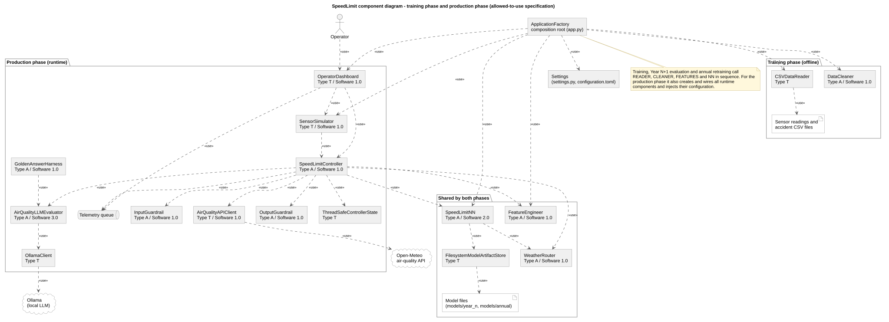
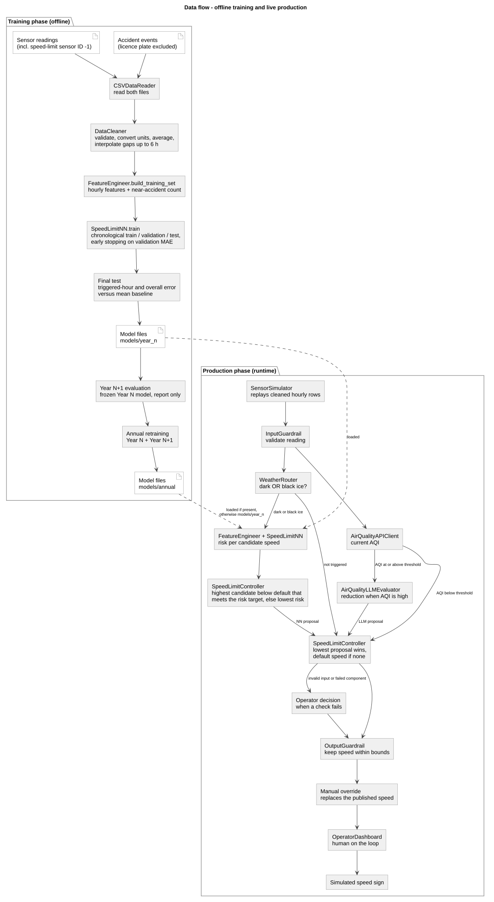

# Exercise 08: Full Architecture, Tests, and Change Requests

## Assignment

Design the SpeedLimit architecture with separate training and production
phases. Name each component and describe it in one sentence, visualize the
architecture, explain how components cooperate, write at least five test
cases for each component, and explain how the design changes for:

1. Temperature sensors that report Fahrenheit.
2. Counting only skidding as a near-accident.
3. Exempting electric cars from an air-quality speed limit.

## Existing Evidence

### Components and responsibilities

- **Application and settings:** compose the application, validate policy and
  technical configuration, and start training, evaluation, or runtime work.
- **CSV data reader:** read sensor and accident files and discard
  licence-plate values.
- **Data cleaner and feature engineer:** validate and normalize readings,
  aggregate them by hour, align event labels, and construct the shared model
  features.
- **Neural-network model:** train on historical hourly data, evaluate on
  chronological holdouts, and estimate near-accident rates for supported
  candidate speeds.
- **Model artifact store:** save and load models, training history, reports,
  and plots.
- **Weather router:** activate the NN path for darkness or black-ice danger.
- **Air-quality API client:** fetch and validate current AQ data.
- **Air-quality LLM evaluator and LLM client:** request a bounded reduction,
  parse and validate the response, and isolate model transport.
- **Input and output guardrails:** reject implausible sensor input and keep
  proposed output within configured speed bounds.
- **Speed-limit controller and shared state:** combine weather and AQ
  proposals, choose the lowest valid proposal, and apply the operator's
  fallback speed or override.
- **Sensor simulator and operator dashboard:** replay hourly input; show the
  decision and its explanation, run test scenarios (pausing the replay), and
  accept the operator's speed or override.

### Cooperation

During training, the CSV reader supplies raw records to the cleaner. The
feature engineer creates hourly weather/light features and event-count
labels. The NN trains using chronological train/validation/test periods and
the artifact store persists the selected model and evaluation reports.

During operation, the simulator sends a reading to the controller. Input
guardrails validate it; the router may activate NN candidate scoring. The API
supplies air-quality data and the configured gate may invoke the LLM evaluator.
The controller combines valid proposals, checks the output guardrail and
reports the decision to the dashboard. On required
component failure it does not choose a speed itself: the dashboard asks the
operator to choose one based on the current or last available metrics.

### Change requests

1. **Fahrenheit sensors:** each temperature sensor's unit is configured in
   `temperature_units_by_sensor` (configuration.toml), and the helper function
   `normalize_temperature()` in `source/data_pipeline.py` converts the
   readings of sensors marked `F` to Celsius during cleaning, before bounds
   checks and hourly aggregation. Implemented and tested.
2. **Only skidding is a near-accident:** set `near_accident_types = ["skidding"]`
   in configuration.toml. No code change or new release is needed.
3. **Exempt electric cars from AQ limits:** the current hourly aggregate and
   global sign have no trusted vehicle identity, so they cannot make a
   vehicle-specific exception. A safe design would require a verified
   vehicle-specific input and an explicit policy at the vehicle/control
   boundary, plus privacy, spoofing, and legal review. This change is not
   implemented.

Automated tests cover behavior and failures with 100% line and branch
coverage.

## Test Cases by Component

Each row names existing test functions (in [tests](../../tests/)). Parameterized
tests contain several concrete cases, so one name can stand for many inputs
(equivalence classes, boundary values, invalid inputs, failures).

| Component | Test file | Test cases |
| --- | --- | --- |
| Application and configuration | [test_app.py](../../tests/test_app.py), [test_settings.py](../../tests/test_settings.py) | `test_factory_runs_training_pipeline`, `test_factory_builds_runtime_and_connects_listener`, `test_year_plus_one_evaluation_is_saved_without_safety_claim`, `test_annual_retraining_evaluates_before_training`, `test_apply_overrides_preserves_defaults_and_applies_flags`, `test_headless_runner_finishes_and_propagates_callback_error`, `test_shipped_config_is_valid_and_matches_the_specification`, `test_validation_rejects_invalid_settings`, `test_all_numeric_fields_reject_nonfinite_values`, `test_loader_rejects_nonfinite_toml` |
| CSV data reader | [test_data_io.py](../../tests/test_data_io.py) | `test_reader_detects_delimiter_and_decimal_separator`, `test_reader_surfaces_missing_file`, `test_headerless_sensor_reading_uses_known_columns`, `test_accident_reader_excludes_licence_plate_case_insensitively`, `test_delimiter_fallback_detects_present_separator`, `test_delimiter_detection_fails_for_unseparated_input` |
| Data cleaner and feature engineer | [test_data_pipeline.py](../../tests/test_data_pipeline.py) | `test_sensor_cleaning_rules`, `test_accident_cleaning_rules`, `test_missing_columns_raise_a_clear_error`, `test_fahrenheit_sensor_is_normalized_before_hourly_aggregation`, `test_event_policy_can_count_only_skidding`, `test_interpolation_requires_complete_gap_within_limit`, `test_interpolation_does_not_fill_unbounded_measurement_gaps`, `test_training_and_inference_features_are_identical`, `test_inference_rejects_incomplete_readings`, `test_candidate_features_reject_empty_candidates` |
| Neural-network model | [test_nn_model.py](../../tests/test_nn_model.py) | `test_training_persists_report_model_history_and_prediction`, `test_training_rejects_too_few_training_rows`, `test_training_rejects_candidate_speeds_outside_bounds`, `test_training_rejects_nonfinite_validation_scores`, `test_prediction_clamps_negative_risk_to_zero`, `test_prediction_rejects_nonfinite_model_output`, `test_training_uses_validation_mae_for_early_stopping` |
| Model artifact store | [test_nn_model.py](../../tests/test_nn_model.py) | `test_training_persists_report_model_history_and_prediction`, `test_load_rejects_other_strategy_and_missing_bundle`, `test_report_is_persisted_as_json` (tested through the model; fewer than five dedicated cases) |
| Weather router | [test_weather_router.py](../../tests/test_weather_router.py) | `test_course_router_cases` (exercise 10), `test_equivalence_classes_truth_table`, `test_bva_illuminance`, `test_bva_water_level`, `test_bva_temperature` |
| Air-quality API client | [test_air_quality_api.py](../../tests/test_air_quality_api.py) | `test_online_parsing_and_cache`, `test_errors_become_AirQualityAPIError`, `test_unreachable_server_raises`, `test_normalize_rejects_malformed_payloads`, `test_normalize_rejects_negative_or_nonfinite_aqi`, `test_network_error_retries_then_succeeds`, `test_invalid_json_and_http_error_are_wrapped` |
| Air-quality LLM evaluator | [test_air_quality_llm.py](../../tests/test_air_quality_llm.py) | `test_parsing_and_range_check`, `test_unparseable_reply_is_retried_once`, `test_unusable_llm_reply_raises_instead_of_using_a_rule`, `test_llm_transport_error_propagates`, `test_prompt_contains_readings_and_allowed_range`, `test_parser_rejects_malformed_values`, `test_golden_harness_reports_pass_and_empty_result` |
| LLM transport client | [test_llm_clients.py](../../tests/test_llm_clients.py) | `test_complete_posts_chat_json_and_returns_content`, `test_complete_rejects_bad_json_and_wrong_response_shape`, `test_complete_converts_non_string_content_to_string`, `test_http_error_includes_status_and_response_body`, `test_network_errors_are_wrapped` |
| Input and output guardrails | [test_guardrails.py](../../tests/test_guardrails.py) | `test_input_bounds_are_inclusive`, `test_input_rejects_missing_nonfinite_and_nonnumeric`, `test_output_guardrail_enforces_range`, `test_output_guardrail_reports_modifications`, `test_input_bounds_come_from_domain_configuration`, `test_missing_input_field_is_reported_and_filtered` |
| Speed-limit controller | [test_speed_controller.py](../../tests/test_speed_controller.py) | `test_req3_default_when_nothing_applies`, `test_air_quality_threshold_boundary`, `test_lower_of_nn_and_llm_wins`, `test_nn_failure_asks_the_operator`, `test_operator_decision_is_used_until_the_system_recovers`, `test_no_candidate_meets_target_selects_lowest_estimated_risk`, `test_manual_override_publishes_operator_value`, `test_override_is_clamped_by_output_guardrail` |
| Controller state | [test_controller_state.py](../../tests/test_controller_state.py) | `test_state_starts_without_an_override`, `test_state_starts_without_an_operator_speed`, `test_state_stores_and_clears_an_override`, `test_state_stores_and_clears_an_operator_speed` |
| Sensor simulator | [test_sensor_simulator.py](../../tests/test_sensor_simulator.py) | `test_loops_and_keeps_original_timestamps`, `test_without_loop_it_finishes`, `test_pause_and_resume`, `test_failing_callback_does_not_stop_the_feed`, `test_strict_callback_failure_stops_the_feed`, `test_invalid_clock_constructor_is_rejected` |
| Operator dashboard | [test_gui_app.py](../../tests/test_gui_app.py) | `test_presentation_formatters_cover_valid_missing_and_malformed_values`, `test_explain_covers_every_decision_path`, `test_dashboard_build_run_close_and_operator_controls`, `test_dashboard_poll_show_and_log_trimming`, `test_dashboard_scenarios_and_processing_failures`, `test_operator_prompt_applies_speed_and_reruns_scenario` |
