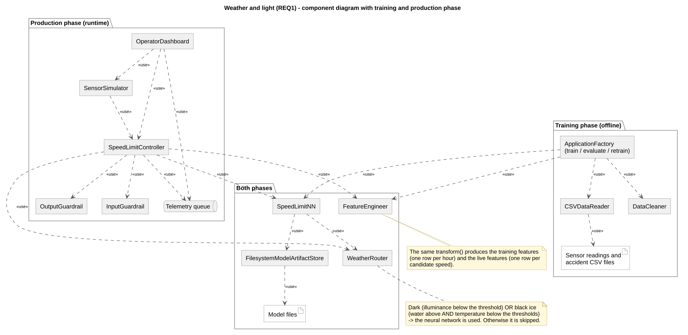

# Exercise 09: Weather and Light Architecture

## Assignment

Design the weather/light part of SpeedLimit with separate neural-network
training and production phases. Name and describe the components, visualize
the architecture, and explain how readings and other inputs become a speed
limit.

## Existing Evidence

### Training phase

1. The CSV reader loads sensor readings and accident records and omits licence
 plates from the application data.
2. The data cleaner normalizes units, validates sensor values, aggregates
 weather and light measurements by hour, and applies the configured
 near-accident event definition.
3. The feature engineer joins each hour to its event count and creates the
 model inputs. Accident counts are labels, not inference-time inputs.
4. The neural network is trained using chronological training and validation
 periods; a separate later test period reports final metrics against a
 simple mean baseline.
5. The artifact store persists the model and its evaluation information.

### Production/simulation phase

1. The sensor simulator supplies an hourly reading to the speed controller.
2. The input guardrail checks the required weather/light values.
3. The weather router activates the neural network if illuminance is below
 500 millilux OR water level is above 1000 micrometers AND temperature is
 below 0 degrees Celsius.
4. When activated, the feature engineer creates one feature row per
 historically supported candidate speed: 40, 50, 60, 70, or 80 km/h.
5. The network estimates the mean near-accident count for each candidate. The
 controller selects the highest eligible candidate estimated at no more
 than one per triggered hour, while requiring a reduction below normal
 speed. If none qualifies, it flags the unmet target and selects the
 lower candidate with the lowest estimated risk.
6. The output guardrail checks the proposed value. The controller publishes
 decision status and telemetry to the operator dashboard.

The training target and candidate predictions are based on observational
records. A prediction for a speed that was not applied in comparable
conditions does not establish a causal safety effect. The architecture is a
course prototype, not an approved traffic-control system.
