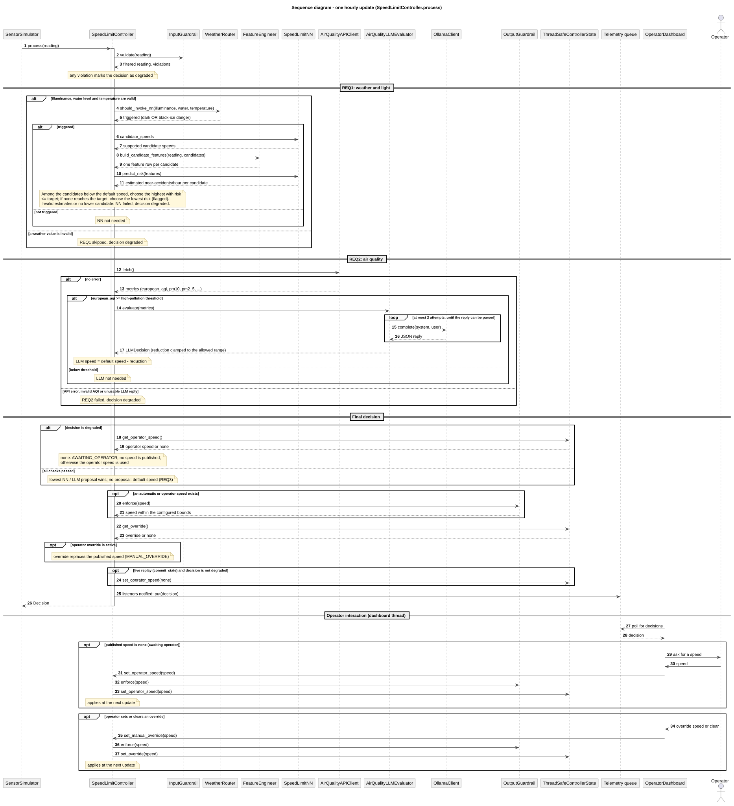

# Exercise 13: Sequence Diagram

## Assignment

Show in a sequence diagram the order in which SpeedLimit components interact
to set the speed limit.

## Existing Evidence

The sequence for one simulated hourly update is:

1. SensorSimulator sends a reading to SpeedLimitController.
2. SpeedLimitController asks InputGuardrail to validate the reading.
3. If weather inputs are valid, the controller asks WeatherRouter whether the
 neural-network route is active.
4. If darkness or black-ice danger is detected, the controller obtains the
 supported candidate speeds, asks FeatureEngineer to build one feature row
 per candidate, and asks SpeedLimitNN to estimate each risk.
5. The controller selects an eligible weather proposal according to the
 configured target and reduction policy.
6. The controller asks AirQualityAPIClient for current AQ data. If the API
 succeeds and the configured AQI trigger is met, it asks
 AirQualityLLMEvaluator for a bounded reduction.
7. If a required service fails, the controller does not choose a speed: it
 marks the decision and the dashboard asks the operator to choose one.
8. The controller combines valid proposals, checks the final value with
 OutputGuardrail, applies an operator override if one is set, and sends the
 decision to OperatorDashboard through the telemetry queue.
9. Operator speed and override are set from the dashboard and apply at the
 next update.

This describes the prototype's simulated control flow, not an approved
sequence for real-road signs.
