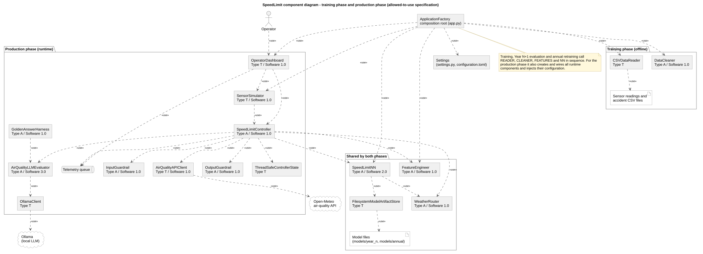

# SpeedLimit Project: Decisions, Architecture, and Open Questions

This record explains the project owner's prototype choices, not stakeholder
safety approval. The [requirements specification](./requirements_specification.md)
records the course intent and precise prototype rules. The case study is the
course source, not a validation of project-selected thresholds.

## 1. Course vocabulary used in this project

| Course concept | Meaning here |
| --- | --- |
| Requirements engineering | Identify stakeholders, clarify needs and assumptions, and express requirements in a testable form before treating implementation choices as requirements. |
| A-software / T-software (software blood types) | A-software implements application-domain behavior; T-software implements technical concerns such as files, HTTP, GUI, and timers. Keep each component focused on one type. |
| SRP and DRY | Single Responsibility Principle and Don't Repeat Yourself: one responsibility should have one clear home, and shared rules should not be implemented inconsistently in multiple components. |
| Software 1.0 / 2.0 / 3.0 | Hand-written deterministic logic / a model trained from data / a prompted foundation model such as an LLM. |
| Training / inference | Offline preparation and evaluation of a model / use of the already-trained model to make a runtime prediction. |
| Feature engineering | Convert raw sensor and event records into the time-aligned numeric inputs a model can use. |
| Guardrail / harness | Deterministic validation around an AI component. A guardrail bounds inputs or outputs; it does not prove that the AI result is correct or safe. |
| Human-on-the-loop (HOTL) | The system runs autonomously while an operator observes it and can intervene. This differs from requiring approval of every individual decision. |
| Traceability | Link each requirement to its design component, verification evidence, and known limitation. |
| Equivalence partitioning / Boundary Value Analysis | Test representative valid and invalid input classes and values at or near rule boundaries. |

The training and runtime paths are described in exercises 09 and 13.

## 2. Project Decision Records

| ID | Topic | Decision | Status / implementation note |
| --- | --- | --- | --- |
| D-01 | Weather trigger | Follow the formal specification: the NN path is triggered by darkness **or** black-ice danger. Darkness means illuminance below 500 millilux. Black-ice danger means water above 1000 µm **and** temperature below 0°C. | **Implemented.** `WeatherRouter` implements these thresholds. The original brief says “bad weather,” so this interpretation must be confirmed with stakeholders. |
| D-02 | Model target | Predict near-accidents per hour conditional on weather/light and candidate speed; select the highest supported candidate below the normal speed whose predicted mean meets the target. | **Implemented.** This remains an observational prediction, not a causal safety effect. |
| D-03 | Model inputs | Use weather/light features and speed from sensor ID `-1` in training; at inference, score candidate speeds. Do not use future accident outcomes as inference features. | **Implemented.** Shared `FeatureEngineer` supports training and candidate inference. Sensor 16 is assumed to be traffic but remains outside the current feature set. |
| D-04 | Candidate speeds | Evaluate only historically observed candidate limits: 40, 50, 60, 70, and 80 km/h. Do not silently extrapolate to 20 or 30 km/h. When REQ1 is triggered, only candidates below the normal speed (80 km/h) count, so the result is always a reduction. | **Implemented.** If none meets the estimated target, D-10 applies. |
| D-05 | Safety metric | Primary metric: mean near-accident count in triggered hours; report the all-hours mean secondarily. | **Implemented for reporting.** Evaluation-window, uncertainty, sample-size, and acceptance rules remain open. |
| D-06 | Evaluation split | Use chronological train, validation, and untouched test periods; validation selects the model/epoch. | **Implemented.** The Year N held-out result remains above target and is slightly worse than its mean baseline. |
| D-07 | Year N+1 | Evaluate the Year N model on Year N+1 first; record that out-of-time result; then include new data in annual retraining. | **Implemented.** This result is independent of Year N+1 retraining; another unseen period is needed to evaluate the retrained model. |
| D-08 | Component failure | If a decision input or required component fails, the system does not choose a speed on its own. The dashboard asks the operator to choose one, showing the current metrics or the last available ones; that speed applies until the system can decide again. | **Implemented and tested.** Escalation policy and physical sign behavior while waiting still need stakeholder definition. |
| D-09 | Normal speed | 80 km/h is published only when all inputs and services are valid and neither REQ1 nor REQ2 requires a reduction (REQ3). | **Implemented.** Failures never fall back to 80 km/h automatically. |
| D-10 | No candidate meets risk target | Do not claim a candidate meets the target. Flag the condition and select the candidate below normal speed with the lowest estimated risk (ties go to the lower speed). Ask the operator only if no candidate below normal speed exists. | **Implemented.** Pending stakeholder approval. |
| D-11 | Air quality | Keep European AQI >= 60 as the deterministic trigger and 10-20 km/h as the LLM amount range. These are configurable, unvalidated project assumptions. | **Project-owner prototype choice, not stakeholder safety approval.** Original REQ2 gives the LLM the whether-and-how-much decision; here code decides whether to invoke it. This scope gap, thresholds, location and policy remain pending. |
| D-12 | Sensor 19 | Exclude sensor 19 from the temperature feature and treat it as unknown until its type is confirmed. | **Implemented.** Sensor 19 is omitted; its type remains unconfirmed. |
| D-13 | Licence plates | Do not use, log, or retain plate values in the application, model, derived datasets, or reports. | **Implemented at ingestion.** `CSVDataReader` does not read the column; the cleaner returns only event time and type. Supplied source CSVs are unchanged. |
| D-14 | Architecture | Enforce A/T separation in code: technical file/network/UI/timer concerns belong in T components; domain requirements and policy belong in A components. | **Implemented.** CSV and artifact I/O, HTTP, Ollama transport, GUI, simulator, and shared locking are technical components; domain transforms, rules, model and controller remain application components. T modules import only shared field names from A modules (CSV column names, the AQI key), never domain logic. |
| D-15 | Sensor 16 classification | Assume sensor 16 contains traffic readings (cars per second); do not add it to the current weather/light model features. | **Project assumption.** Source metadata does not confirm the per-sensor type or unit; verify before using it as a feature. |

## 3. Requirement baseline and traceability

| Requirement | Testable interpretation for the prototype | Main component(s) | Evidence / limitation |
| --- | --- | --- | --- |
| REQ1 / SPEC1 | On valid readings, darkness is illuminance `< 500` millilux. | `WeatherRouter` | Boundary-value tests exist for 499 and 500. |
| REQ1 / SPEC2 | Black-ice danger is water `> 1000` µm **and** temperature `< 0°C`. | `WeatherRouter` | Boundary-value tests exist for both strict thresholds. |
| REQ1 / SPEC3 | Learn the relation among weather/light, recorded speed, and near-accident count. | Data pipeline and `SpeedLimitNN` | **Implemented as observational risk regression.** It does not estimate a causal effect of changing speed. |
| REQ1 / SPEC4 | Count skidding, close-car, and close-guardrail events as near-accidents. | `DataCleaner`, `FeatureEngineer` | Configurable event policy and hourly alignment are implemented. |
| REQ1 safety target | Triggered-hour average near-accident count is at most 1/hour. | Risk model and evaluation | **Not demonstrated.** See the evaluation figures in section 6. |
| REQ2 prototype | With valid air-quality data at or above the configured assumed threshold, request an LLM reduction within the configured range. | API client, LLM evaluator, controller | Mocked tests exercise the harness. Deterministic gating differs from original LLM decision scope; see D-11. |
| REQ3 | With valid data and neither REQ1 nor REQ2 active, use 80 km/h. | Controller | Existing branch/test exists. Missing data must not be mistaken for a confirmed “no reduction needed” result. |
| Privacy | Do not use or retain licence plates in the application path. | Data ingestion and logs | `CSVDataReader` omits the plate column; cleaned records and model inputs contain only required fields. Source CSVs are unmodified. |
| Human oversight | Operator can observe decisions, run test scenarios (which pause the live replay), choose the speed when the system cannot, and override it. | Dashboard/controller | Prototype behavior exists; authorization, expiry, audit, and operating procedures are unresolved. |

## 4. Model limitations

Data structure and source-data concerns are recorded in [data notes](./data.md).

The dataset is observational. A model trained on recorded limits can estimate
associations in the observed data; it cannot by itself prove what would have
happened under a speed limit that was not actually applied (a counterfactual).
The estimated mean of at most one near-accident per triggered hour is a
prototype decision proxy, not evidence that the desired *realized* safety
outcome has been achieved. Candidate speeds outside the observed range are
unsupported extrapolations and are excluded by D-04. Any real-world causal or
safety claim would need an independently approved validation method. The
reported percentile bootstrap interval resamples individual triggered hours
and does not account for temporal autocorrelation; it is descriptive, not a
safety acceptance interval. Year N's recorded candidate support is uneven:
40 km/h has seven hourly observations, versus 55 at 50, 258 at 60, 97 at 70,
and 327 at 80. No candidate-specific minimum support rule has been approved.

An aggregate mean at or below 1/hour also does not guarantee that every hour or
every road situation is safe. Report sample sizes and uncertainty, compare
against a baseline, and do not describe the result as a safety certification.

## 5. Implemented architecture

The [component table](./README.md#canonical-component-table) lists each
component's responsibility, A/T blood type and software generation. The
related decisions are D-03 (shared model inputs), D-08 (operator handling),
D-14 (A/T separation) and D-15 (sensor assumption).

## 6. Verification evidence

### Model evaluation method

1. Split chronologically into train (60%), validation (20%) and test (20%).
2. Fit the feature scaler only on training data.
3. Select the number of epochs on validation data (early stopping), then
   refit on train + validation for that many epochs.
4. Evaluate once on the untouched test period.
5. Report for triggered hours: number of hours, mean near-accidents/hour and a
   bootstrap interval; report the all-hours mean as a secondary metric.
6. Compare against a mean baseline and record the support per candidate speed.
7. Evaluate the Year N model on Year N+1 before using Year N+1 for annual
   retraining.

### Model results

Figures from the saved models (`report` in each `speedlimit_nn.joblib`) and
[year_plus_one_evaluation.json](../models/year_plus_one_evaluation.json):

| Evaluation | Hours (triggered) | Triggered mean: observed / predicted (95% interval) | MAE vs. mean baseline |
| --- | --- | --- | --- |
| Year N model, held-out test (last 20% of Year N) | 149 (74) | 1.270 / 1.267 (1.027-1.541) | 0.921 vs. 0.890 |
| Year N model on Year N+1 | 744 (389) | 1.031 / 1.236 (0.933-1.134) | 0.874 vs. 0.873 |
| Annual model, held-out test (last 20% of Year N + N+1) | 298 (141) | 2.206 / 2.194 (1.957-2.461) | 1.147 vs. 1.209 |

None of these demonstrates the 1/hour target. The Year N model does not beat
the mean baseline; the annual model does slightly on its held-out test, which
lies at the end of Year N+1, so a later unseen period is still needed. The
interval resamples single hours and ignores temporal autocorrelation. These
observational figures are not a causal or safety certification. Exercise 07
discusses the Year N+1 result.

### Automated tests

[pytest.ini](../pytest.ini) requires 100% line and branch coverage. Last run on
2026-11-13 (Windows, Python 3.14.0): **344 tests passed; 1,701 statements and
374 branches covered (100%).**

The suite applies the course test-design techniques: the router uses all
eight dark/wet/freezing combinations as equivalence classes and boundary
values around each threshold (the four exercise rows R-01 to R-04 run in
`test_course_router_cases`); guardrail tests cover inclusive bounds and
invalid-value classes; the controller checks AQI just below, at and above its
trigger. The LLM evaluator and its golden-answer harness are tested with
scripted replies; the "golden" ranges are engineering assumptions, not
validated answers. Live Ollama, live API and GUI usability are checked
manually, not by the suite.

## 7. Stakeholder questions

The open questions are in
[stakeholder_meeting_notes.md](./stakeholder_meeting_notes.md). They are a
course deliverable; real answers or deployment approvals are not required for
the submission.
