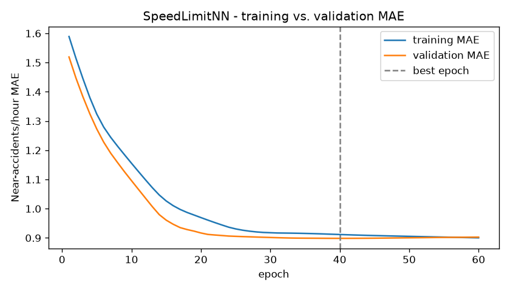
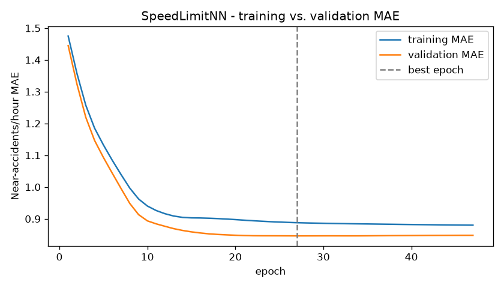

# Training and Retraining Report

## Year N training

The lines show the average prediction error during training (blue) and on data held aside while training (orange). Lower is better. Both errors fall quickly and then flatten. The lowest validation error is at epoch 40, marked by the dashed line. This shows learning progress, but does not by itself prove that predictions will work well on future data.

## Annual retraining

This model was trained using data from Year N and Year N+1. Both errors fall sharply at first. The validation error remains above the training error and is still falling at epoch 300, the configured limit. The chart does not show that the model has finished improving.

## Check on Year N+1

Before retraining, the Year N model was checked against Year N+1. Its average absolute error was 0.874 near-accidents per hour; a simple average-based estimate scored 0.873. These results are almost the same, and the model did not improve on that simple estimate in this check. See [the full evaluation](year_plus_one_evaluation.json).

Year N+1 was then included in annual retraining, so it cannot also prove how well the annual model works on future data. That needs a later period that was not used for training. The data is observational: these results do not prove that changing a speed limit causes fewer near-accidents.
